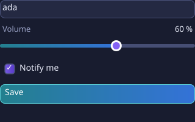
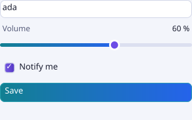
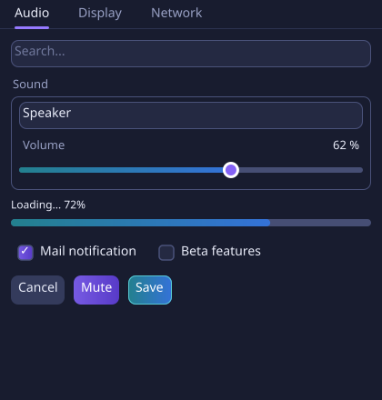
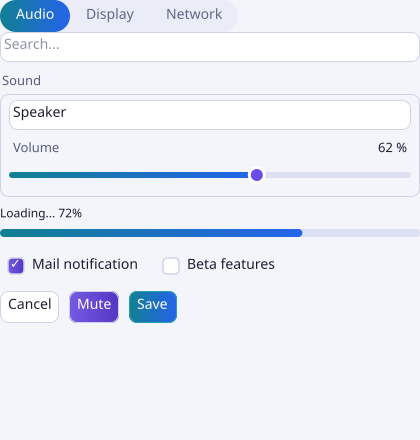

# Themes

A theme is the set of colors and shapes every widget draws with. PRISM ships a modern look, in
dark and light: rounded boxes, pill-shaped controls, gradients on whatever is "on", and space
between the widgets of a stack. The look PRISM had before stays available as the classic themes.
An app can follow the system's choice, pick one, or bring its own.

## Follow the system

One line makes the app light or dark as the system is set, and switch when the user changes it:

```cpp
#include <prism/prism.hpp>
using namespace prism;

struct Form {
    core::Field<ui::TextField<>> name{{.value = "ada", .placeholder = "Name"}};
    core::Field<ui::Slider<>> volume{{.value = 60, .min = 0, .max = 100, .step = 1,
                                      .label = "Volume", .unit = "%"}};
    core::Field<ui::Checkbox> notify{{.checked = true, .label = "Notify me"}};
    core::Field<ui::Button> save{{.text = "Save"}};

    void view(app::ViewBuilder& vb) { vb.vstack(name, volume, notify, save); }
};

int main() {
    Form form;
    return app::run(form, {.title = "Form"}, [](app::AppContext& ctx) {
        ctx.follow_system_theme();
    });
}
```

The same form, dark and light:




## Pick one

`ctx.set_theme(theme)` sets every window's theme at once and stops following the system:

```cpp
app::run(form, {.title = "Form"}, [](app::AppContext& ctx) {
    ctx.set_theme(ui::light_theme());
});
```

You may call it again at any time on the logic thread, from a menu choice for example. Every
widget repaints with the new colors in the same frame.

| Call | What it does |
|---|---|
| `ui::dark_theme()` | The default theme: the modern look, light text on dark surfaces. Same as `ui::modern_dark_theme()`. |
| `ui::light_theme()` | The modern look, dark text on light surfaces. Same as `ui::modern_light_theme()`. |
| `ui::classic_dark_theme()`, `ui::classic_light_theme()` | The look before the modern one: square boxes, flat colors, no spacing. |
| `ctx.set_theme(const ui::Theme&)` | Every window takes this theme. Stops following the system. |
| `ctx.follow_system_theme()` | Light or dark as the system is set, now and when it changes. Dark until the system answers. |
| `ctx.system_prefers_dark()` | What the system asks for, last time it said. |
| `ctx.theme()` | The theme the windows use now. |

Every shipped theme keeps every text at WCAG AA contrast (4.5:1) against what it is drawn on,
both ends of the gradients included. A test checks it.

The modern look in dark and light:




## Make your own

A `ui::Theme` is a plain struct of colors and a few shape values. Start from a shipped one and
change what you need:

```cpp
ui::Theme brand() {
    ui::Theme t = ui::light_theme();
    t.primary        = core::Color::rgba(200, 60, 20);   // buttons
    t.primary_hover  = core::Color::rgba(215, 75, 35);
    t.primary_active = core::Color::rgba(180, 50, 15);
    t.primary_fill   = ui::Gradient{core::Color::rgba(200, 60, 20), core::Color::rgba(170, 40, 60)};
    t.accent         = core::Color::rgba(200, 60, 20);   // slider thumbs, ticked boxes
    t.accent_fill    = ui::Gradient{t.accent, t.accent}; // flat
    return t;
}

// in setup, or later on the logic thread:
ctx.set_theme(brand());
```

### Color roles

Each member is one role. A widget picks the role, never a color, so a new theme reaches every
widget. `_hover` and `_active` variants are used under the pointer and while pressed.

| Group | Members | Used for |
|---|---|---|
| Surfaces | `surface`, `surface_hover`, `surface_active` | The fill of input widgets: fields, boxes, combo boxes. |
| Primary | `primary`, `primary_hover`, `primary_active`, `primary_outline` | Buttons. |
| Accent | `accent`, `accent_hover`, `accent_active` | Slider thumbs, ticked checkboxes, chosen radio buttons. |
| Text | `text`, `text_muted`, `text_placeholder`, `text_on_primary` | Text; secondary text; a field's hint while empty; text on a button. |
| Borders | `border`, `border_hover`, `focus_ring` | Outlines; the ring around the widget with the keyboard focus. |
| Tracks | `track`, `track_hover`, `scrollbar_thumb` | Slider and scroll bar tracks; the scroll bar's handle. |
| Dividers | `divider`, `divider_hover` | The handle between split panes. |
| Editing | `cursor`, `text_selection`, `text_match` | The caret; selected text; search hits. |
| Documents | `link`, `code_bg`, `current_line`, `gutter` | Links; code blocks; a code editor's caret line and line-number column. |
| Syntax | `syntax_keyword`, `syntax_type`, `syntax_string`, `syntax_number`, `syntax_comment`, `syntax_preprocessor`, `syntax_function` | The colors of highlighted code. |
| Popups | `popup_bg`, `popup_border`, `popup_highlight`, `scrim` | Menus and drop-down lists; the row under the pointer; the shade behind a modal dialog. |
| Errors | `error` | Input that was refused. |
| Tables | `table_row_even`, `table_row_odd`, `table_selected`, `table_header`, `table_divider`, `table_header_divider`, `table_header_text` | Table rows, the selection, the header. |
| Tabs | `tab_bar_bg`, `tab_active_bg`, `tab_text`, `tab_text_active`, `tab_accent` | The tab bar, the open tab, its underline. |
| Window frame | `chrome_bg`, `chrome_border`, `chrome_text`, `chrome_icon`, `chrome_close` | The title bar PRISM draws, and its close button under the pointer. |
| Canvas | `canvas_bg` | The background behind everything. |

`core::Color::rgba(r, g, b, a)` makes a color; `a` defaults to 255 (opaque).

### Shapes and spacing

| Member | Classic | Modern | What it does |
|---|---|---|---|
| `corner_radius` | `0` | `8` | The rounding of boxes: fields, buttons, cards, popups, menus, tooltips. |
| `pill_controls` | `false` | `true` | Fully rounded ends on the tab bar and slider tracks. |
| `spacing` | `0` | `10` | The gap a stack leaves between its children. A stack with a `vb.gap()` of its own keeps only its own gaps. |
| `primary_fill` | `primary`, flat | teal to blue | A primary button, a progress bar, a slider's filled track, the open tab. |
| `accent_fill` | `accent`, flat | lavender to violet | A ticked checkbox, a chosen radio button, a toggle that is on. |

A fill is a `ui::Gradient{from, to}`, horizontal unless its `axis` says vertical. A gradient whose
two colors are equal draws as a flat fill. If you change `primary` in a modern theme, change
`primary_fill` too: the gradient is what the widgets show.

## Icons that follow the theme

A one-color icon drawn in a fixed color disappears on one of the two themes. Load it as
*symbolic*: it is then drawn in the color of the text beside it.

```cpp
std::shared_ptr<const render::Image> save_icon() {
    auto img = render::load_image("icons/save.svg", core::Size{core::Width{16}, core::Height{16}});
    return img ? render::symbolic(*img) : nullptr;   // a missing file: no icon
}

core::Field<ui::Button> save{{.text = "Save", .icon = save_icon()}};
```

A logo or a photo keeps its own colors: load it without `symbolic`.

## In Python

```python
prism.set_theme("light")    # or "dark", "system", "classic_dark", "classic_light"
```

It may be called from any thread while an app runs.

## Pitfalls

- `set_theme` stops following the system. Call `follow_system_theme()` again to go back.
- A custom theme made from `dark_theme()` keeps dark-theme colors in every role you leave alone.
  Check the text against its background if you change surfaces.
- The modern themes space a stack's children 10 points apart. A layout tuned with hand-written
  `vb.gap()` calls keeps its gaps; one that relied on widgets touching gets the spacing. Use a
  classic theme, or set `spacing = 0`, to keep the old layout.
- `load_image` returns an error rather than throwing: check it before calling `symbolic`.
