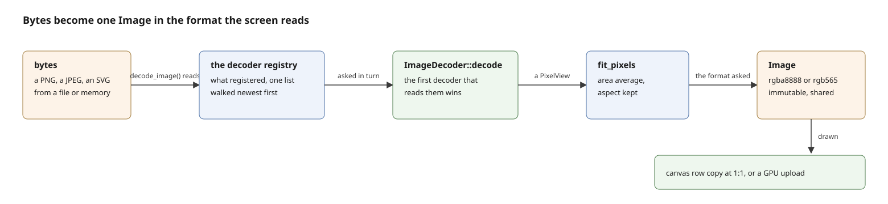

# Images

`render::Image` is a picture the render thread can draw: pixels that never change, shared by
pointer, each backend uploading it once and caching it by `id()`.

```cpp
auto image = prism::render::Image::from_rgba(2, 1, {255, 0, 0, 255, 0, 255, 0, 255});
if (image) {
    auto cmd = prism::render::ImageCmd{.image = *image, .rect = /* where it goes */ {}};
}
```

## Two pixel formats

An image says how its pixels are stored, so a backend can hand them to the screen without
converting them first.

| Format | Bytes a pixel | Alpha | Where it pays |
| --- | --- | --- | --- |
| `rgba8888` | 4, in R, G, B, A order | straight | Everything that blends: icons, photos, anything drawn over a background. |
| `rgb565` | 2, one native-endian `uint16_t` | none, opaque | A panel that reads 565 directly: no conversion, half the memory and half the bandwidth. |

Build one with `Image::from_rgba(width, height, bytes)` or
`Image::from_rgb565(width, height, words)`. Both check the size and hand back
`std::expected<shared_ptr<const Image>, std::string>`. `format()`, `width()`, `height()` and
`pixels()` describe what you got; `pixels()` is always a span of bytes, whichever format it is.

An `rgb565` image has no alpha. Draw it opaque: a tint still applies, an alpha below 255 does not.

## Resizing and converting

`render/image_ops.hpp` holds the one routine behind both, so a picture is averaged the same way
wherever it is shrunk.

```cpp
auto small = prism::render::scaled(image, prism::core::Size{prism::core::Width{32}, prism::core::Height{32}});
auto packed = prism::render::converted(image, prism::render::PixelFormat::rgb565);
```

`fit_pixels(view, box, format)` does the work. It takes a `PixelView` — bytes, `width`, `height`,
`stride` in bytes, and a `SourceFormat` of `rgb888`, `rgba8888` or `rgb565` — and writes an `Image`
in `format` that fits `box`, keeping the aspect ratio.

Three rules to remember:

1. It never enlarges. A picture smaller than the box comes back at its own size.
2. Each output pixel is the area average of the source rectangle it covers, so a shrunk photo is
   averaged rather than sampled.
3. A stride longer than a row is stepped over, not read. Lines the producer padded out are safe.

`scaled` and `converted` are the two usual cases on top of it. Both hand back the same pointer when
nothing has to change, so a caller that converts defensively wastes nothing.

## Decoding a file

Decoders are registered backends, like audio devices. `decode_image` asks the most recently
registered one first and stops at the first that can read the bytes.

```cpp
auto image = prism::render::decode_image(
    bytes, {.fit = prism::core::Size{prism::core::Width{64}, prism::core::Height{64}},
            .format = prism::render::PixelFormat::rgb565});
if (!image) log(image.error());
```

`DecodeOptions` carries what you want: `fit`, the box to scale into (the picture's own size when
omitted), and `format`, the pixel format to hand back. `load_image` does the same for a path.

A decoder writes a `class ImageDecoder`: one `decode(bytes, options, error)` that returns the image,
or null with a message when the bytes are not its format. Register it with `register_decoder`,
unregister with `unregister_decoder`, and `decoders()` lists what is live, newest first.

What a caller sees when nobody can read the bytes:

| Situation | `error()` |
| --- | --- |
| No decoder registered | `"no image decoder"` |
| Every decoder failed | the message from the last one tried |
| A decoder threw | the exception's `what()` |
| A decoder returned null without a message | `"the image decoder failed"` |

On the desktop the SDL3_image decoder registers itself when the backend library loads, so PNG, JPEG
and SVG work with no call of your own. On a board there is no library to load: call the board's
registration from `app_main`, as in [Embedded boards](../project/embedded.md).



*Bytes go through the registered decoders once, then through the area average: what comes out is an
image in the format the screen wants.*

## Painting a picture

`raster::paint_image<P>` freezes a canvas into an image: handy for a widget that draws its own
picture, or for a trace you want to keep.

```cpp
auto trace = prism::raster::paint_image<prism::raster::Rgb565>(
    64, 32, [](prism::raster::Canvas565& canvas) {
        canvas.fill_rect({prism::core::Point{prism::core::X{0}, prism::core::Y{0}},
                          prism::core::Size{prism::core::Width{64}, prism::core::Height{32}}},
                         prism::core::Color::rgba(0x20, 0x80, 0xff));
    });
```

The canvas starts empty: fully transparent for `Argb8888`, black for `Rgb565`. Both sizes must be
positive, or you get null.

## Pitfalls

- Ask for `rgb565` only when the destination reads it. A `rgba8888` backend converts every
  `rgb565` image it draws.
- A decoder runs on whichever thread asks, so one that cannot run twice at once must serialise
  itself.
- `decode_image(bytes, svg_size)` is the older spelling: it passes the box as `fit`, so a bitmap
  given a box is scaled too, where it used to load at its own size.
