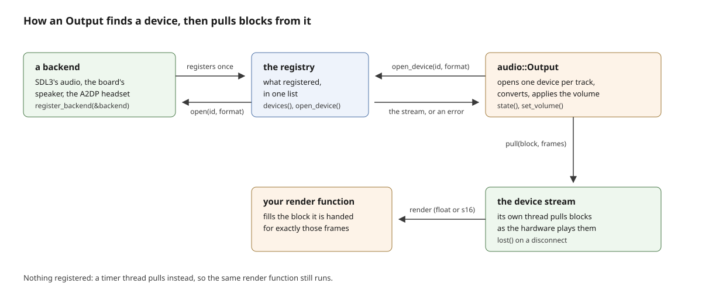

# Audio

`audio::Output` plays sound. You give it a function that fills a block of samples. It calls that function on a real-time thread of its own, as fast as the sound card plays.

## A tone you can tune

```cpp
struct Tone {
    core::Field<ui::Slider<>> pitch{{.value = 440, .min = 110, .max = 880, .step = 1,
                                    .label = "Pitch", .unit = "Hz"}};
    core::Field<ui::Checkbox> play;

    core::Latest<float> to_audio{440.f};   // logic thread writes, audio thread reads
    std::unique_ptr<audio::Output> output;

    float phase = 0.f;

    void attach(app::AppContext&) {
        pitch.observe([this](const auto& p) { to_audio.publish(static_cast<float>(p.value)); });
        play.observe([this](const auto& p) {
            if (p.checked) {
                output = std::make_unique<audio::Output>(
                    audio::Format{}, [this](std::span<float> out) { render(out); });
            } else {
                output.reset();
            }
        });
    }

    void render(std::span<float> out) {
        const float hz = to_audio.read();
        const float step = hz / 48000.f;
        for (std::size_t i = 0; i + 1 < out.size(); i += 2) {
            const float sample = std::sin(phase * 6.2831853f) * 0.2f;
            out[i] = out[i + 1] = sample;
            phase += step;
            if (phase >= 1.f) phase -= 1.f;
        }
    }

    void view(app::ViewBuilder& vb) { vb.vstack(pitch, play); }
};

int main() { app::run(Tone{}, {.title = "Tone", .width = 320, .height = 120}); }
```

Three threads meet here. The logic thread owns the fields and publishes the pitch into `core::Latest`. The audio thread reads the latest pitch once per block and never waits. The render thread draws.

`observe` belongs to the field, not to the app: a field carries its own listeners.

## Choosing the device

`audio::Output` plays through a device backend. The platform's backend is registered as the program loads: SDL's devices on the desktop, a board's speaker and headset on an embedded target. `audio::devices()` lists what is there now.



*`Output` finds a device, the device pulls blocks, `Output` converts when the types differ.*

| Constructor | Which device |
| --- | --- |
| `Output(Format, render)` | the first default device that accepts the format |
| `Output("speaker", Format, render)` | the device with that id, or `State::lost` |
| `Output(Format, render)` with nothing registered | the timer (still renders, plays nowhere) |

`state()` says what happened, and it is worth checking once:

| `audio::State` | Meaning |
| --- | --- |
| `playing` | The device accepted the format and pulls blocks. |
| `timer` | No device opened; a timer calls the render function instead. |
| `lost` | The device was asked for and went away, or never opened. Sticky. |

`playing()` is `state() == State::playing`. `error()` says why a device was not used.

## Which samples to fill

A render function hands `frames * channels` interleaved samples per block. Two kinds exist, and the one you pick decides who converts:

| Function type | Samples | Conversion |
| --- | --- | --- |
| `audio::RenderFn` | `float`, -1..1 | none when the device is float; converted when it is not |
| `audio::SampleRenderFn<std::int16_t>` | `std::int16_t`, -32768..32767 | none when the device is 16-bit |

A board's speakers and headsets are 16-bit, so a board passes `SampleRenderFn<std::int16_t>` and does exactly the work the codec wants. The desktop's sound card is float, so `RenderFn` costs nothing there. `Output` converts once per block, only when the two differ, and never allocates while doing it.

`set_volume(v)` takes 0..1. `Output` hands it to the device when the device can apply it in hardware — a codec's own volume control, say — and otherwise scales the samples itself.

## When there is no sound card

No device registered, or none that accepts the format, changes nothing for your code: a timer thread calls the same render function on the same schedule, one thread at a time. `state()` says `timer` instead of `playing`. In the browser, audio needs a user gesture before it will start.

## Writing a device backend

A backend is two small classes and one call to `audio::register_backend`:

```cpp
class MyStream final : public audio::DeviceStream {
public:
    bool lost() const override;                  // true once the device is gone
    bool set_volume(float volume) override;      // true when the device took it
};

class MyBackend final : public audio::DeviceBackend {
public:
    std::vector<audio::DeviceInfo> devices() override;
    std::unique_ptr<audio::DeviceStream> open(std::string_view id, const audio::Format& format,
                                              audio::PullFn pull, std::string& error) override;
};
```

`devices()` describes what can be opened: an id, a name, the rates it accepts (empty means any), its channel count, its native sample type, and whether it is the default. `open()` starts the device and hands it the pull function; from then on the device calls `pull(block, frames)` whenever it needs samples.

Three rules make an `Output` safe around a stream:

1. `pull` may be called before `open()` returns. Do not assume the caller has finished setting up.
2. Once `lost()` is true, stop calling `pull`. You cannot be destroyed while a pull is inside you, so this is what tells the owner to let go.
3. The stream's destructor must not return while a pull runs. Wait for it.

If your device is one unit of hardware that outlives any single `Output` — an audio codec with one DMA writer, a Bluetooth link that stays up between tracks — put an `audio::RenderGate` between the two. The device's writer thread calls `gate.call(block, frames)`; each `Output` calls `attach(&its_pull)` when it starts and `detach()` when it dies, and `detach()` returns only when no call is inside. A call with nothing attached returns `false` and writes nothing, which is how the writer plays silence between tracks.

## Testing

`audio::ManualDevice` is a device you drive by hand: `pull_s16(frames)` pulls a block as the sound card would, `lose()` disconnects it, and `device_volume()` reports what `set_volume` reached. No sound card, no timing, no threads of its own.

```cpp
audio::ManualDevice device{audio::SampleType::s16};
audio::Output out{"manual", audio::Format{.sample_rate = 48000, .channels = 2},
                  audio::SampleRenderFn<std::int16_t>{[&](std::span<std::int16_t> block) { /* fill */ }}};
REQUIRE(out.state() == audio::State::playing);
auto block = device.pull_s16(512);   // 512 frames, 1024 samples
```

## Reference

`audio::Format`

| Field | Default | Meaning |
| --- | --- | --- |
| `sample_rate` | 48000 | Frames per second. |
| `channels` | 2 | Interleaved channels. |
| `block_frames` | 512 | What the device asks for at a time. |

`audio::DeviceInfo`

| Field | Meaning |
| --- | --- |
| `id`, `name` | What `Output` names and what a person reads. |
| `rates` | Accepted sample rates; empty means any. |
| `max_channels` | 1 for mono, 2 for stereo. |
| `native` | `SampleType::s16` or `f32`: what the device takes without conversion. |
| `is_default` | The device a default-constructed `Output` looks for first. |

`audio::Output`

| Member | Meaning |
| --- | --- |
| `Output(Format, render)` | The default device, or the timer. |
| `Output(id, Format, render)` | That device, or `State::lost`. |
| `state()`, `playing()`, `error()` | What happened, in that order of detail. |
| `format()` | The format it was asked for. |
| `set_volume(v)` | 0..1, in hardware when possible. |
| `load()` | `max_ms`, `mean_ms`, `calls`, `budget_ms`: how close rendering comes to the deadline. |

## Pitfalls

- No lock, allocation, file read or `Field` access in a render function. It runs on a real-time thread.
- Destroy the `Output` before anything it captures. A pull can be in flight until the destructor returns.
- A device backend registered from a library nothing references is dropped by the linker. That is why the SDL backend's sources live in `prism-software-backend`, and why a board registers its own from its own component.
- There is no Python binding for audio.
