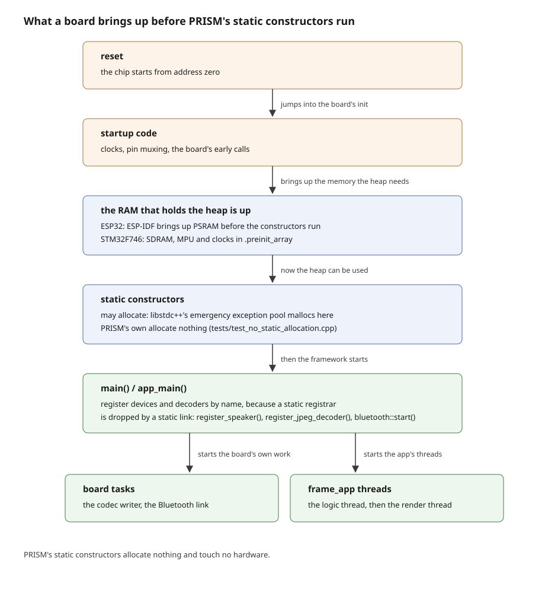

# Embedded boards (STM32, ESP32)

PRISM runs on a microcontroller with a screen: the STM32 port and the ESP32-S31-Korvo-1
port are the two that ship. This page lists what changes on a board, and the three rules
that keep a firmware from failing in ways that are hard to see.

## Build options that matter on a board

These are in `meson_options.txt`. They exist because flash and RAM are small.

| Option | Default | What you save | What you lose |
| --- | --- | --- | --- |
| `-Dfmt_locale=false` | on | about 184 KiB on the Cortex-M builds: `{fmt}`'s `{:L}` path and libstdc++'s locale facets | `{:L}` formatting; `{fmt}` ignores the flag |
| `-Dline_breaking=simple` | `unicode` | about 100 KiB: libunibreak's UAX #14 tables | the finer Unicode line-break rules; spaces, hyphens and CJK ideographs still break |
| `-Dembedded_bold_face=false` | on | about 20 KiB: the bold embedded face | bold text is drawn with the regular face |

Turn on the ones that pay only if your text does not need them. A firmware with a
localized date format needs `fmt_locale`. A firmware of Latin text does not.

The three options are ordinary Meson options, so a board port sets them in its own
cross file or in the `meson setup` line of its component.

## Nothing may allocate before `main`

Static constructors run before `main`, on a heap that the SDK has not set up and a PSRAM
that is not yet mapped. A `std::vector`, a `std::string` or a `std::function` built in a
namespace-scope constructor therefore allocates into a heap that does not exist.

The rule:

- A static constructor may not allocate.
- It may not rely on a registration surviving: a static registrar is dropped by a static
  link. Boards register their devices and decoders by name from `main` / `app_main`.
- It may not touch hardware, a bus or a clock that the SDK has not configured.

`tests/test_no_static_allocation.cpp` holds PRISM to that rule: it replaces the global
`operator new` before `main`, records every allocation made by static constructors, and
fails the test if there is one. A board port that adds a static object runs the same
test, which is how the cost of a global stays visible.

## A backend registration needs a linked object file

`register_backend()` and `register_decoder()` do nothing if the object file that calls
them is dropped. A linker drops members of a static library that nothing references, and
a registrar mentions nothing but itself.

On a board, call the registration from `app_main`:

```cpp
void app_main() {
    prism::esp32::register_speaker();
    prism::esp32::register_jpeg_decoder();
    // ...
}
```

On the desktop, the SDL backend's sources live in `prism-software-backend`, the library
a program links when it makes an `Output` or decodes an image, and `sdl_registered.hpp`
holds the registrar as a single object the library owns.
[`prism-mp3-player`](https://github.com/PRISM-GUI/prism-mp3-player), an app built on the ESP32
port, links that library for its audio, so the registration cannot be dropped.

## Boot order on a board



*What must be up before static constructors, then `main`, then the tasks.*

Read it top to bottom. The heap, the PSRAM and the drivers come before anything
allocates. Static constructors allocate nothing and touch no hardware. `app_main` (or
`main`) registers the board's own devices and decoders, installs its port
(`platform::set_port`), then starts the tasks and runs the app.

## Flash and RAM

A board build links the same `libprism` the desktop does, minus the optional parts the
options above switch off. What still costs flash:

- the embedded fonts, in `raster/fonts.cpp`, which carry only the faces you compiled in;
- the image formats your decoders support, since a decoder pulls in its library;
- the profiling tools, which a board build leaves off unless asked for.

Measure before guessing: `idf.py size-components` on ESP-IDF, `arm-none-eabi-size` on an
STM32 build.

## The two ports

Both are separate repositories: PRISM holds no board code.

| Board | Repository | What runs |
|---|---|---|
| ESP32-S31-Korvo-1 | [prism-esp32](https://github.com/PRISM-GUI/prism-esp32) | an ESP-IDF project whose `prism` component builds PRISM with Meson |
| STM32H7B3I-DK | [prism-stm32](https://github.com/PRISM-GUI/prism-stm32) | a cross build of the same sources |

Each repository's README has its clone, build, flash and console commands. The board a
repository targets:

| | ESP32-S31-Korvo-1 |
|---|---|
| Chip | ESP32-S31: two RISC-V cores at 320 MHz |
| Memory | 16 MB PSRAM, 16 MB flash |
| Screen | 4.3" 800×480, parallel RGB, RGB565 on a 16-bit bus |
| Touch | GT1151 over I2C |
| Audio | ES8389 codec: two microphones and a speaker output |
| Toolchain | ESP-IDF at a pinned commit (the repository's Docker image), GCC 16 |

On the ESP32, the panel and touch are PRISM's `BandSink` and `TouchSource`, the speaker an
`audio::Output` sink and the microphones an `audio::Input` capture backend, and Bluetooth the
port's `prism_bt` component. On the STM32, the same split holds, with the panel driver and the
audio codec in the board component.

Neither port's flash and RAM figures are quoted here: they move with the compiler and the
options. Measure your own build with `idf.py size-components` (ESP32-IDF) or
`arm-none-eabi-size` (STM32).

## Starting a board port

A port writes only what its board owns. `include/prism/platform/frame_target.hpp` is the
display and touch contract, `platform/port.hpp` is what the port hands PRISM once at startup,
and `platform/frame_app.hpp` (the frame runtime itself) is what its `run_frames` calls.

Four pieces, in the order they are needed:

| Piece | What it provides |
|---|---|
| Linker script and startup code | where the heap, the PSRAM and the stacks live |
| A display driver | `platform::FrameSink` (a full frame) or `platform::BandSink<P>` (bands) |
| A touch driver | `platform::TouchSource`: `read()` returns the touched point, or nothing |
| `app_main` | registers the board's devices and decoders, then calls the app |

`FrameSink` is what the rasterizer draws into:

| Member | What the port does |
|---|---|
| `back()` | returns the ARGB8888 pixels for the next frame, stride = width |
| `clear(argb)` | optional: fill it with the engine, return `true` |
| `clear_rect(x0, y0, x1, y1, argb)` | optional: the same for a damage rectangle |
| `present()` | shows what was drawn into `back()` |
| `size()` | the frame's size in pixels |
| `buffer_age()` | 1 or 2: how many presented frames `back()` still holds, so the runtime knows what it must redraw |

`BandSink<P>` is the same idea for a panel fed band by band: `band_height()`, `band(index)`,
`flush(index, first_row, rows)`, `present()`, `size()`, `frame_age()`.

The app starts with one call, from `app_main` or `main`, as it does on the desktop:

```cpp
int main()
{
    Mixer mixer;
    return prism::app::run(mixer, {.title = "Mixer"});   // the same call as on the desktop
}
```

On a target built as a board (`PRISM_FRAME_PORT`, set when the system is `none`), `app::run`
forwards to `prism::platform::run`: the port's frame runtime, a real `app::AppContext` (the
model's `attach(AppContext&)`, cross-thread posts, `open_window`), and the panel as the app's one
window. The title, the window size and the settings are the desktop's and are ignored there, and
so is a timed quit: the run ends when the app closes its window.

What the board supplies, once, before `main` -- from `app_main`, from its startup code, or from a
static initializer:

```cpp
#include <prism/platform/port.hpp>

prism::platform::set_port({
    // The board's own run: its sink, its touch source, its thread attributes, its scale.
    .run_frames = [&sink, &touch](prism::platform::TreeFactory make_tree,
                                  std::function<void(prism::platform::FrameContext&)> setup) {
        prism::platform::run_frames(sink, touch, std::move(make_tree), std::move(setup),
                                    {.ui_scale = 1.5f});
    },
    .on_stats = [](std::string_view line) { /* the console, or a Wi-Fi log */ },
});
```

`platform::FrameOptions` still sets `ui_scale` (1.5 for a fingertip) and `before_thread_start`,
which is where a port sets its thread priorities and core pinning. `FrameContext::quit()` stops
the loop, and the run returns after that. Those are the port's own pieces; an app never sees them.

`examples/embedded/` holds the apps both boards run, one `main()` each
(`examples/embedded/*_main.cpp`: `widgets_main.cpp`, `scope_main.cpp`, `tone_main.cpp`). They are
built on every target and on the desktop, and exported as `prism_embedded_apps_dep`. Sound comes
in through `prism::audio::Input`: a port registers a `CaptureBackend` for its microphones or ADC
(the STM32 its ADC, the ESP32 its microphones) and the scope records from it, falling back to its
generated sweep when nothing opened. Sound out goes through `audio::Output`, which a port backs
with its codec the same way.

`tests/cross/none-cortex-m7.ini` is the cross file to start from, and `ports/freertos/` (the
POSIX layer, profile clock, system counters and `sbrk`) is what a `none` target gets unless
`-Dfreertos_port=disabled` says the SDK has its own. The MPS2-AN500 QEMU board in
`ports/qemu_mps2/` runs the same path without hardware, and CI builds it.
