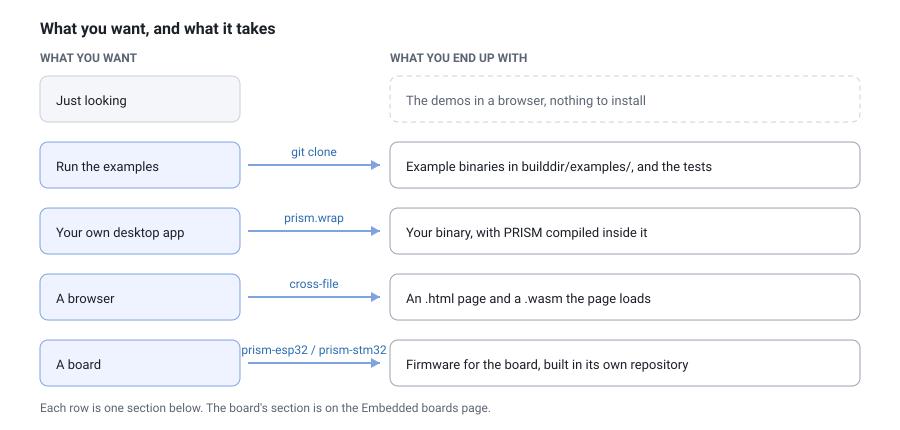

# Install and build

This page gets PRISM built and its examples running, on the desktop and in the browser.

## Which path are you on?



*Five ways in. Each is one section below; the board row lives on [Embedded boards](../project/embedded.md).*

- **Just looking:** the [live demos](https://prism-gui.github.io/PRISM/) need no install.
- **Building PRISM itself**, to run the examples and the tests: [Build and test](#build-and-test).
- **Your own program on the desktop:** [Use PRISM in your project](#use-prism-in-your-project).
- **In a browser:** [In the browser](#in-the-browser).
- **On a board:** [Embedded boards](../project/embedded.md). Its options matter more than
  the ones below.

## What you need

- [Meson](https://mesonbuild.com) 1.5 or newer, and Ninja.
- A C++ compiler from the table below.
- Nothing else: Meson fetches every dependency (SDL3, stdexec, fmt, doctest, magic_enum, Glaze).

| Compiler | Reflection | What you write |
|---|---|---|
| GCC 16 or newer | yes, found by the build | nothing: a struct becomes a window |
| GCC 14+, Clang 17+ | no | a short `view()` method per struct |
| Emscripten 6.0.10+ (the browser) | no | a short `view()` method per struct |

Reflection is C++26 static reflection (P2996).
Without it, everything still works: you place the fields yourself in `view()`.
[Your first app](first-app.md) shows both.

## Build and test

```bash
git clone https://github.com/PRISM-GUI/PRISM.git
cd PRISM
meson setup builddir
ninja -C builddir
meson test -C builddir
```

Then run an example:

```bash
./builddir/examples/tour/01_struct_to_ui
./builddir/examples/widget_gallery/widget_gallery
```

## Build options

Pass them to `meson setup`, as in `meson setup builddir -Dexamples=disabled`.
For PRISM as a subproject, prefix the name: `-Dprism:tests=disabled`.

What gets built:

| Option | Default | What it adds |
|---|---|---|
| `examples` | auto | the example apps |
| `tests` | auto | the C++ and Python test suites |
| `benchmarks` | auto | the benchmarks |
| `prism_debug_tools` | auto | the live inspector on Ctrl+Shift+I |
| `http` | auto | `prism-net`: HTTP requests (not in the browser) |
| `io` | auto | `prism-io`: TCP and serial ports (not in the browser) |
| `markdown` | auto | `prism-markdown`: Markdown into a document |
| `webgpu` | disabled | the WebGPU renderer, see below |

`auto` builds a part when Meson finds what it needs.

Where it runs:

| Option | Default | What it decides |
|---|---|---|
| `sdl` | auto | the SDL backend, the Python bindings, the tests, the examples and the benchmarks. Off on a bare-metal host, where there is no SDL |
| `freertos_port` | auto | PRISM's own FreeRTOS kernel and POSIX layer (`ports/`). Disable it when your SDK brings its own, as ESP-IDF does |

A board build usually passes `-Dsdl=disabled` too: without a window, there is nothing for the
SDL backend to do.

Flash, RAM and profiling:

| Option | Default | What it changes |
|---|---|---|
| `fmt_locale` | true | off drops `{fmt}`'s `{:L}` path and libstdc++'s locale facets: about 184 KiB on a Cortex-M build |
| `line_breaking` | `unicode` | `simple` drops libunibreak's tables (about 100 KiB) and keeps spaces, hyphens and CJK breaks |
| `embedded_bold_face` | true | off drops the bold embedded face (about 20 KiB); bold text is drawn in the regular face |
| `profiling` | disabled | compiles the `PRISM_PROFILE_*` marks in, with a global recorder |
| `profiling_events` | 65536 | events in each thread's ring |
| `profiling_threads` | 32 | thread rings |

[Embedded boards](../project/embedded.md) explains the three size options, and when each one
pays.

## Use PRISM in your project

PRISM builds from source inside your project. There is no `meson install` step and no
pkg-config file: it is a subproject, and your build compiles it.

Three files and two commands.

```text
my_app/
  meson.build
  main.cpp
  subprojects/prism.wrap
```

`subprojects/prism.wrap` fetches PRISM:

```ini
[wrap-git]
url = https://github.com/PRISM-GUI/PRISM.git
revision = main
```

`main` is the branch: PRISM has no release tags yet. Pin a commit instead if you want a build
that does not move.

`meson.build` links it:

```meson
project('my_app', 'cpp', default_options : ['cpp_std=c++26'])

prism_dep = subproject('prism', default_options : [
  'examples=disabled', 'tests=disabled', 'benchmarks=disabled',
]).get_variable('prism_dep')

executable('my_app', 'main.cpp', dependencies : prism_dep)
```

```bash
meson setup builddir
ninja -C builddir
```

The three `default_options` are not optional in practice. Without them, PRISM's eight example
apps, its test suites and its benchmarks build with your program.

`prism_dep` brings the whole framework and the default window backend. It also carries the flags
the headers need (`-freflection` on a compiler that has it, and the `PRISM_*` defines), so your
targets compile the way PRISM's own do.

Your code includes one header:

```cpp
#include <prism/prism.hpp>
```

[Your first app](first-app.md) is a `main.cpp` that goes in this layout as it is.

## In the browser

The same code builds for the web with [Emscripten](https://emscripten.org).
Upstream Clang has no reflection, so each struct needs a `view()` there.

```bash
source /path/to/emsdk/emsdk_env.sh
meson setup builddir-wasm --cross-file cross/wasm32-emscripten.ini
ninja -C builddir-wasm
meson test -C builddir-wasm        # the tests run under node
emrun builddir-wasm/examples/widget_gallery/widget_gallery.html
```

Anything that links `prism_dep` gets the browser setup for free:
SDL3 from Emscripten's ports, the fonts bundled in, and JSPI so the event loop can wait without
freezing the page.

Two things the page needs:

- PRISM uses threads, so the server must send the COOP and COEP headers. `emrun` does.
- JSPI needs Chrome 137+, Firefox 153+ or Safari 27.

The [live demos](https://prism-gui.github.io/PRISM/) are this build of the examples.
`scripts/build_web_site.sh` builds the same site on your machine.

## The WebGPU renderer (experimental)

PRISM draws with SDL's renderer by default.
A build with `-Dwebgpu=enabled` adds a WebGPU renderer, on Linux and macOS.
Pick it for one run with an environment variable:

```bash
meson setup builddir -Dwebgpu=enabled
PRISM_RENDERER=webgpu ./builddir/examples/model_notes/model_notes
```

Or pick it in code, on a backend you create yourself:

```cpp
auto backend = app::Backend::software({.renderer = app::Renderer::WebGpu});
auto& window = backend.create_window({.title = "Notes"});
app::model_app(backend, window, notes);
```

Only the drawing changes: windows, input and the clipboard stay SDL's.
Without a GPU, Mesa's software Vulkan (lavapipe) works too.
A window that cannot get a WebGPU surface falls back to SDL's renderer, with a warning.

## The C++ features PRISM uses

| Feature | Used for | Required |
|---|---|---|
| Static reflection (P2996) | a window from a struct | no: `view()` is the fallback |
| `std::execution` (P2300) | the event loop | yes, through stdexec |
| Concepts | picking a widget for a type, geometry types | yes |
| `std::expected` | errors returned, not thrown | yes |
| Designated initializers | `{.value = 0.5, .max = 1.0}` | yes |
| magic_enum | a dropdown for an enum | only without reflection |
